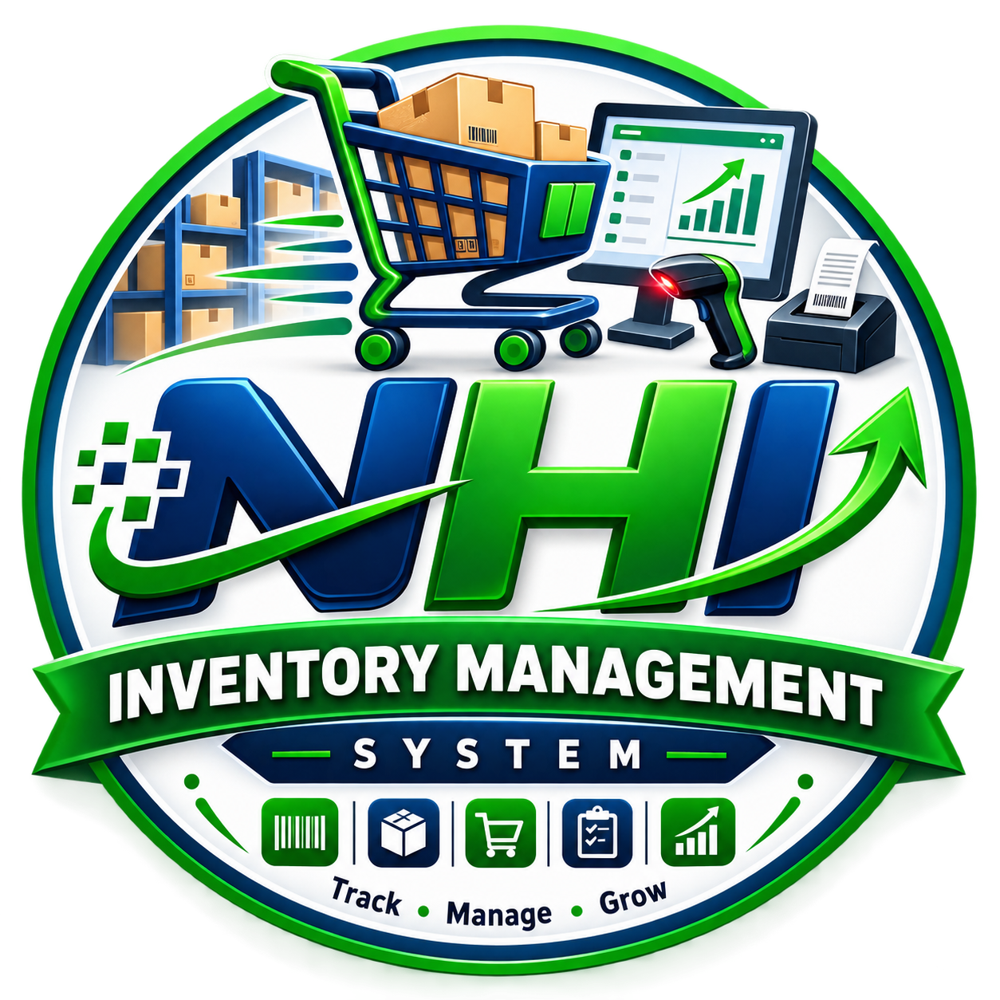

<p align="center">
  
</p>

<h1 align="center">NHI Inventory Management System</h1>

<p align="center">
  A fast, fully <strong>offline</strong> desktop application for retail shops — inventory, point&nbsp;of&nbsp;sale,
  customer &amp; supplier <em>khata</em> ledgers, expenses, employees and reporting.
  Built with .NET&nbsp;8 (WPF) and SQLite. English &amp; Urdu (RTL) interface.
</p>

---

## Table of contents

- [Features](#features)
- [Tech stack](#tech-stack)
- [Repository structure](#repository-structure)
- [Windows installation (end users)](#windows-installation-end-users)
- [Build & run from source](#build--run-from-source)
- [Building the Windows installer](#building-the-windows-installer)
- [Login information](#login-information)
- [Data storage & backup](#data-storage--backup)
- [What is (and is not) in this repository](#what-is-and-is-not-in-this-repository)
- [License & credits](#license--credits)

---

## Features

| Area | Highlights |
| --- | --- |
| **Point of Sale** | Barcode scanning (USB scanner + webcam via OpenCvSharp/ZXing), hold &amp; resume sale, multiple payment methods, receipt printing |
| **Inventory** | Products, categories, brands, units, stock adjustments, barcode label sheets, low-stock visibility |
| **Purchases** | Purchase entry and **purchase returns** with stock &amp; ledger reversal |
| **Sales** | Sales history, sale details, **sales returns** with stock &amp; ledger reversal, reprint last receipt |
| **Khata (Ledgers)** | Customer &amp; supplier ledgers, receive/pay payments, dues tracking, WhatsApp message history |
| **Expenses** | Categorised expense tracking |
| **Employees** | Employee records, attendance, salary posting, employee ledger |
| **Daily Closing** | End-of-day cash summary and history |
| **Reports** | Profit summary and operational reports with **Excel export** (ClosedXML) |
| **Printing** | Configurable receipt &amp; report layouts, universal print preview, thermal/POS friendly |
| **Administration** | Multi-shop support, users &amp; roles, audit log, in-app **Backup &amp; Restore** |
| **Localisation** | English and Urdu with full right-to-left support |
| **Offline-first** | No internet connection required; all data stored locally |

## Tech stack

- **.NET 8** (`net8.0-windows`) — **WPF** desktop UI
- **Entity Framework Core 8 + SQLite** for the local database
- **MaterialDesignThemes / MaterialDesignColors** for the UI
- **CommunityToolkit.Mvvm** for MVVM plumbing
- **ClosedXML** (Excel export), **QuestPDF** (printing/PDF), **ZXing.Net** &amp; **OpenCvSharp4** (barcode)
- **Microsoft.Web.WebView2** (WhatsApp integration)
- **BCrypt.Net-Next** for password hashing

## Repository structure

```
.
├── README.md                      # This file
├── .gitignore                     # Excludes build output, IDE state, databases and secrets
├── NHi.Inventory.sln              # Visual Studio solution
├── src/
│   └── NHi.Inventory/             # Application source (WPF project)
│       ├── App.xaml(.cs)          # Startup, font registration, global error handling
│       ├── Data/                  # EF Core DbContext, schema upgrades, seed data
│       ├── Models/                # Entity models
│       ├── Services/              # Business logic (sales, inventory, printing, backup, …)
│       ├── Converters/            # WPF value converters
│       ├── Themes/                # XAML styles & colour themes
│       ├── Resources/             # Embedded icon, logo, Urdu font, UI strings (en/ur)
│       └── Views/                 # Screens & dialogs, grouped by area
│           ├── Admin/ Inventory/ Khata/ More/ POS/ Printing/ Reports/ Settings/
├── installer/
│   ├── NHiInventory.iss           # Inno Setup 6 script (Windows installer)
│   ├── build-installer.ps1        # One-command build: publish + compile installer
│   └── README.txt                 # End-user installation notes shipped beside Setup.exe
├── docs/
│   ├── INSTALLATION.md            # Detailed Windows installation guide
│   ├── USER-GUIDE.md              # How to use the main modules
│   └── BUILD.md                   # Building, running and troubleshooting from source
├── assets/
│   ├── company-logo.png           # Branding/logo used in the docs
│   └── fonts/                     # Third-party font attribution/notes
└── scripts/
    └── build.bat                  # Convenience build script (restore + build)
```

There is currently **no automated test project**; the solution has no test suite to run.
See [docs/BUILD.md](docs/BUILD.md) for verification steps.

## Windows installation (end users)

The application ships as a self-contained Windows installer, so **no extra runtime needs to be installed**.

**System requirements**

- Windows 10 or Windows 11 (64-bit)
- ~400 MB free disk space
- No internet connection required

**Steps**

1. Download `NHI-Inventory-Setup.exe`.
2. Double-click it to start the installation.
3. If Windows SmartScreen shows a warning, verify you obtained the installer from a trusted source before continuing.
4. Approve the User Account Control (UAC) prompt if asked.
5. Follow the wizard and choose an install folder (default: `C:\Program Files\NHI Inventory Management System`).
6. Keep **Create a desktop shortcut** selected if you want quick access.
7. Click **Install**, wait for completion, then **Finish**.

A more detailed guide is in [docs/INSTALLATION.md](docs/INSTALLATION.md).

## Build & run from source

**Prerequisites**

- Windows 10/11 (64-bit)
- [.NET 8 SDK](https://dotnet.microsoft.com/download/dotnet/8.0) (with the .NET Desktop workload)

```bat
:: 1. Clone
git clone https://github.com/niaz-codes/Inventory-Management-System-.git
cd "Inventory-Management-System-"

:: 2. Restore + build (Release)
dotnet restore src\NHi.Inventory\NHi.Inventory.csproj
dotnet build   src\NHi.Inventory\NHi.Inventory.csproj -c Release

:: 3. Run
dotnet run --project src\NHi.Inventory\NHi.Inventory.csproj
```

Or simply run the helper script (double-click or from a terminal):

```bat
scripts\build.bat
```

The built executable is produced at `src\NHi.Inventory\bin\Release\net8.0-windows\NHi.Inventory.exe`.

> **Note:** In `Debug` builds only, sample/test data is seeded automatically
> (`Data/TestDataSeeder.cs`). `Release` builds start with a clean database.

## Building the Windows installer

Requires [Inno Setup 6](https://jrsoftware.org/isinfo.php) (`winget install JRSoftware.InnoSetup`).

```powershell
pwsh -File installer\build-installer.ps1              # version from the .csproj
pwsh -File installer\build-installer.ps1 -Version 1.1.0
```

This publishes the app self-contained for `win-x64` into `installer\publish\`, compiles
`installer\NHiInventory.iss`, and produces `installer\Output\NHI-Inventory-Setup.exe`.
The generated `publish\`, `Output\` and `*.exe` artifacts are **git-ignored** and are not
committed (the setup executable is over GitHub's file-size limit and is rebuilt on demand).

## Login information

- **Shop user** — username `user`, password `user`.
- **Administrator** — the `admin` account is created automatically on first run, and its
  password is **never stored in this repository**. Set the `NHI_ADMIN_PASSWORD` environment
  variable before the first launch to choose it, or the app generates a strong random password
  and shows it **once** on the first-run screen.

> ⚠️ **Write the administrator password down when it is first shown, and change it after
> signing in.** Do not share credentials with unauthorised users. The administrator can create
> additional users and shops from **Settings → User Management** and **Shop Management**.

## Data storage & backup

Your business records are stored **locally** on your computer:

```
%LOCALAPPDATA%\NHiInventory\
```

This folder contains (depending on the features you use):

- `inventory.db` — the SQLite database (shops, products, sales, khata, etc.)
- `*.txt` — application settings (language, scanning preferences, …)
- `crash.log` — diagnostics if the app ever hits an unexpected error

**How to back up**

1. Open the application and go to **Shop Management → Backup & Restore**.
2. Create a backup and store it on a USB drive or another secure location.

Automatic backups run on a schedule; the backup feature is admin-only. To move to another
computer, install the app there and use **Backup & Restore** to restore your records.

> Avoid copying a live database while the application is running — always use the built-in
> backup so the snapshot is consistent.

## What is (and is not) in this repository

**Included:** application source, solution, installer configuration, documentation, branding
assets and build scripts.

**Deliberately excluded** (see `.gitignore`):

- Build output (`bin/`, `obj/`) and IDE state (`.vs/`)
- Installer artifacts (`installer/publish/`, `installer/Output/`, `*.exe`)
- Databases and real user data (`*.db`, `*.sqlite*`, `crash.log`)
- Local secrets and environment overrides (`.env`, `appsettings.*.json`, `*.pfx`, `*.snk`)

The application database and real customer records are **never** committed.

## License & credits

- **License:** refer to the project owner for distribution terms. The bundled
  **Jameel Noori Nastaleeq Kasheeda** Urdu font and the company logo are supplied by the
  project owner; see `assets/fonts/` for the font's attribution notes.
- Third-party libraries are used under their respective open-source licences
  (MaterialDesignInXAML, QuestPDF, ClosedXML, ZXing.Net, OpenCvSharp, WebView2, EF Core,
  BCrypt.Net, CommunityToolkit.Mvvm).

---

<p align="center"><em>NHI Inventory Management System — simple, practical, built for offline business management.</em></p>
